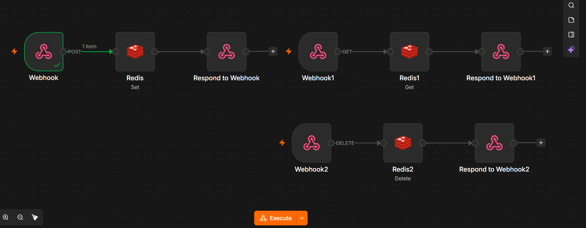
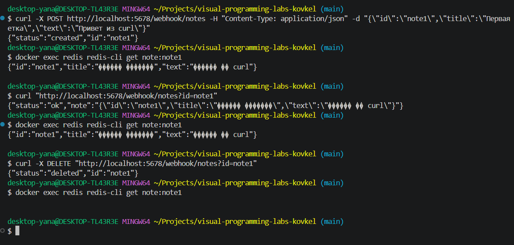

# REST API для заметок на Redis (Ачивка 5.2)

Реализация REST API для CRUD-операций над заметками. Хранилище — Redis.
Реализовано в одном workflow n8n (`flow-11-notes-api`).

## Схема workflow

```
POST   /webhook/notes           → Webhook → Redis (Set)    → Respond to Webhook
GET    /webhook/notes?id=<id>   → Webhook1 → Redis (Get)   → Respond to Webhook1
DELETE /webhook/notes?id=<id>   → Webhook2 → Redis (Delete)→ Respond to Webhook2
```

Все три вебхука используют один и тот же path `notes`, но разные HTTP-методы
(POST / GET / DELETE).



## Ключи в Redis

Формат ключа: `note:<id>`, где `<id>` — идентификатор заметки, переданный клиентом.

Пример: `note:note1`

Значение — JSON-строка с полями заметки (`id`, `title`, `text`).

## Эндпоинты

### 1. Создать заметку

```bash
curl -X POST http://localhost:5678/webhook/notes \
  -H "Content-Type: application/json" \
  -d "{\"id\":\"note1\",\"title\":\"Первая заметка\",\"text\":\"Привет из curl\"}"
```

Ответ:
```json
{"status": "created", "id": "note1"}
```

Что происходит:
1. Webhook принимает POST-запрос с телом JSON.
2. Redis (Set) сохраняет ключ `note:note1` со значением = `JSON.stringify(body)`.
3. Respond to Webhook возвращает `{"status": "created", "id": <id>}`.

### 2. Получить заметку

```bash
curl "http://localhost:5678/webhook/notes?id=note1"
```

Ответ:
```json
{"status": "ok", "note": "{\"id\":\"note1\",\"title\":\"Первая заметка\",\"text\":\"Привет из curl\"}"}
```

Поле `note` — это строка (потому что мы сохраняли через `JSON.stringify`).

### 3. Удалить заметку

```bash
curl -X DELETE "http://localhost:5678/webhook/notes?id=note1"
```

Ответ:
```json
{"status": "deleted", "id": "note1"}
```

После этого `GET` вернёт `{"status": "ok", "note": null}` — заметки больше нет.

## Полный CRUD-цикл (проверено)

```bash
# 1. Создать
curl -X POST http://localhost:5678/webhook/notes -H "Content-Type: application/json" \
  -d "{\"id\":\"note1\",\"title\":\"Первая заметка\",\"text\":\"Привет из curl\"}"
# → {"status":"created","id":"note1"}

# 2. Прочитать из Redis напрямую (для проверки)
docker exec redis redis-cli get note:note1
# → {"id":"note1","title":"Первая заметка","text":"Привет из curl"}

# 3. Прочитать через API
curl "http://localhost:5678/webhook/notes?id=note1"
# → {"status":"ok","note":"{...}"}

# 4. Удалить
curl -X DELETE "http://localhost:5678/webhook/notes?id=note1"
# → {"status":"deleted","id":"note1"}

# 5. Проверить, что удалено
docker exec redis redis-cli get note:note1
# → (пусто)
```



## Проблема
 `404 Not Found — webhook "notes" is not registered`

При отправке curl на **тестовый** URL:

```
http://localhost:5678/webhook-test/notes
```

n8n отвечал:

```json
{"code":404,"message":"The requested webhook \"notes\" is not registered.",
 "hint":"Click the 'Execute workflow' button on the canvas, then try again.
 (In test mode, the webhook only works for one call after you click this button)"}
```

**Причина:** тестовый URL `/webhook-test/...` слушает **только один запрос**
после нажатия кнопки «Listen for test event». Как только запрос пришёл или
если пользователь отвлёкся (переключил вкладку, кликнул на canvas), слушатель
отключается.

**Решение:** **опубликовать workflow** (кнопка **Publish**) и использовать
**Production URL** — `/webhook/notes` (без `-test`). В этом режиме вебхук
работает **постоянно**, без необходимости каждый раз нажимать «Listen».

Проблема: пустой ответ curl и пустой Redis

После нескольких попыток отправки curl на тестовый URL ответ был пустым,
и `docker exec redis redis-cli get note:note1` показывал `(nil)`.

**Причина:** та же — тестовый вебхук не был активен
в момент запроса. curl молча завершался, а запрос до n8n не доходил.

**Решение:** после публикации workflow и перехода на Production URL
(`/webhook/notes`) запросы начали доходить корректно:

```json
{"status":"created","id":"note1"}
```

