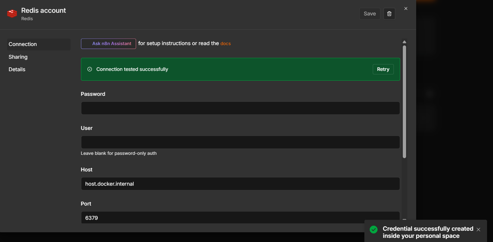
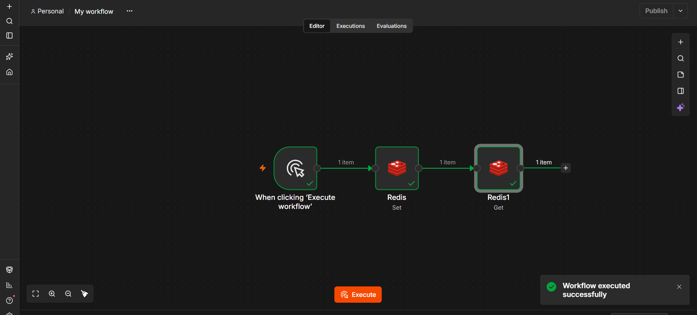
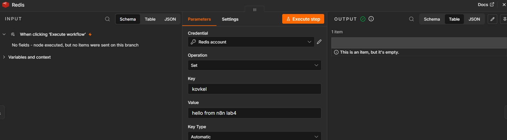
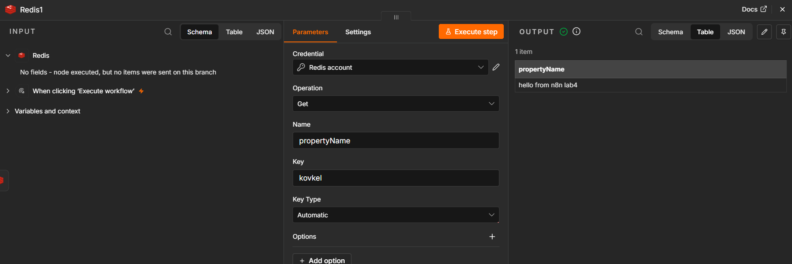
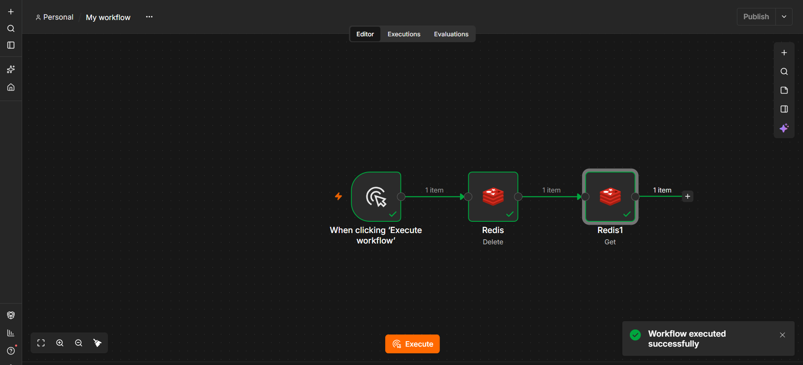
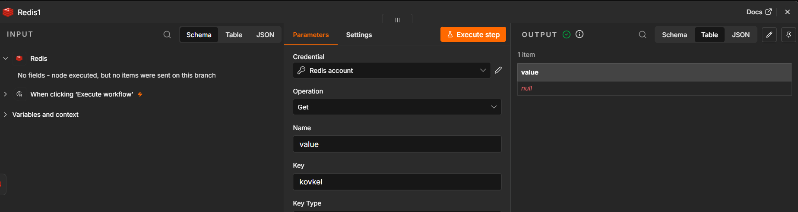

# Redis в n8n — лабораторная работа №4

## Запуск Redis в Docker
Установили:

```bash
docker run -d --name redis -p 6379:6379 redis:7
```

## Credentials в n8n

Создано подключение **Redis account**:
- **Host**: `host.docker.internal`
- **Port**: `6379`
- **Password**: пусто
- **User**: пусто
- **Database Number**: `0`

Соединение проверено — "Connection tested successfully".



## Workflow 1: создание и чтение ключа (flow-09-redis)

Схема: `Manual Trigger → Redis (Set) → Redis (Get)`



1. **Redis (Set)** — записывает ключ:
   - Key: `kovkel`
   - Value: `hello from n8n lab4`
   - Key Type: `Automatic`

   

2. **Redis (Get)** — читает этот же ключ:
   - Key: `kovkel`
   - Name: `propertyName`

   Результат: `{ propertyName: "hello from n8n lab4" }`

   

## Workflow 2: удаление ключа и проверка (flow-10-redis-delete)

Схема: `Manual Trigger → Redis (Delete) → Redis (Get)`



1. **Redis (Delete)** — удаляет ключ `kovkel`.

2. **Redis (Get)** — пытается прочитать удалённый ключ.

   Результат: `{ value: null }` — ключ не найден.

   

> **Примечание:** в установленной версии n8n Redis-нода не имеет операции
> **Exists** (только Delete, Get, Incr, Info, Keys, LLen, LPop, Publish,
> RPush, Set). Поэтому проверка отсутствия ключа выполнена через **Get**:
> если ключ удалён, Get возвращает `null`. Это эквивалентно `Exists = false`.

## Выводы

- Redis легко поднимается через Docker одной командой.
- n8n взаимодействует с Redis через встроенную ноду, credentials настраиваются
  один раз и переиспользуются.
- Важно использовать `host.docker.internal` для доступа из контейнера n8n
  к сервисам на хост-машине.
- Операции Set/Get/Delete покрывают базовые сценарии работы с key-value
  хранилищем.