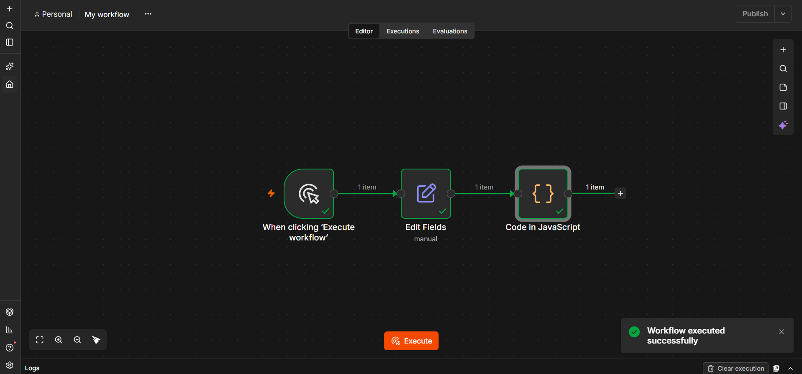
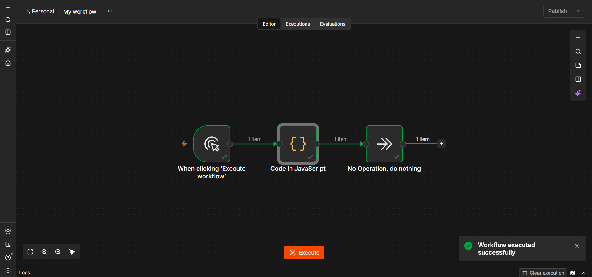
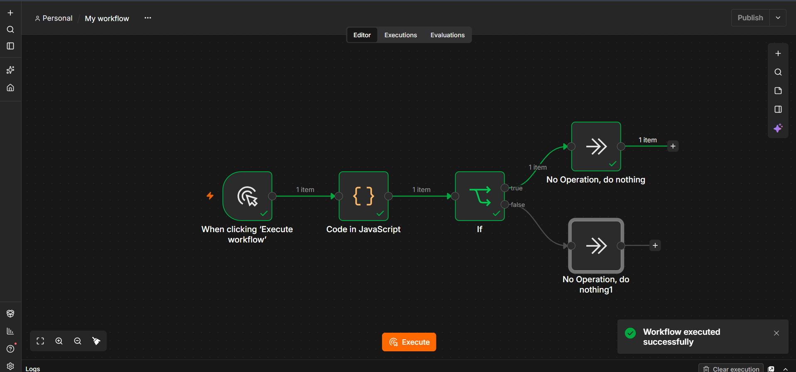
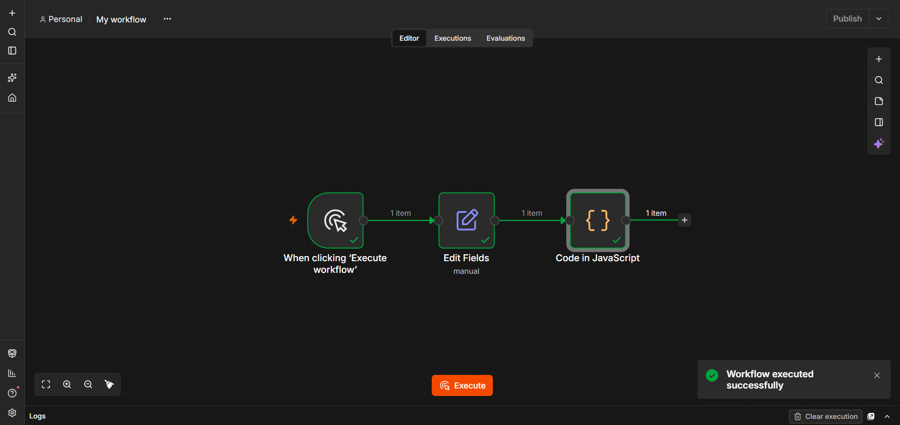
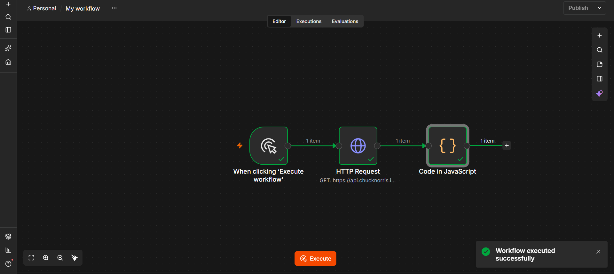
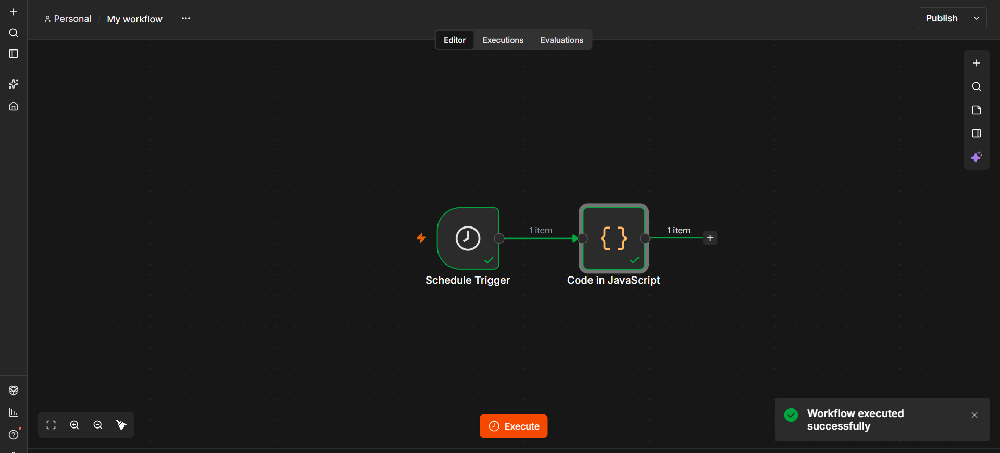

# Лабораторная работа №4. n8n

## Краткое описание выполненного

В ходе лабораторной работы освоена low-code платформа автоматизации **n8n**.
Выполнено:

1. Установка n8n через Docker.
2. Изучены базовые ноды: Manual Trigger, Set (Edit Fields), Code, IF, NoOp,
   HTTP Request, Schedule Trigger.
3. Собраны 6 базовых workflow (flow-01…flow-06) с экспортом в JSON.
4. Установлен и настроен **Redis** через Docker, созданы credentials в n8n.
5. Собраны 2 workflow для работы с Redis (создание/чтение ключа,
   удаление/проверка) — flow-09, flow-10.
6. Взята **ачивка 5.2** — REST API для заметок на Redis (flow-11).

## Какие AI-промпты использовались

В ходе работы использовался AI-ассистент для:

1. Просила написать код для нод Code

2. Вместе с ИИ сделала ачивку, решали проблему

3. Спрашивала какую ачивку лучше взять

## Скриншоты workflow

### flow-01: Manual → Set → Code

### flow-02: Manual → Code → NoOp

### flow-03: Manual → Code → IF → NoOp/NoOp

### flow-04: Manual → Set (topic/timestamp/payload) → Code

### flow-05: Manual → HTTP Request → Code

### flow-06: Schedule Trigger → Code

### flow-09: Redis Set → Get

### flow-10: Redis Delete → Get

### flow-11: REST API для заметок (ачивка 5.2)

## Redis

Подробнее о работе с Redis — в [`redis.md`](./redis.md).

## Ачивка 5.2 — REST API для заметок на Redis

Подробнее — в [`notes-api.md`](./notes-api.md).

## Выводы

В ходе лабораторной работы я освоила установку и запуск n8n через Docker, а также базовые и продвинутые ноды: Manual Trigger, Schedule Trigger, Set, Code, If, NoOp, HTTP Request, Redis, Webhook и Respond to Webhook. Попробовала работать с Redis как с key-value хранилищем: создавать, читать и удалять ключи через встроенную ноду n8n. В рамках ачивки 5.2 реализовала REST API для заметок с полным CRUD-циклом (POST, GET, DELETE), используя ноды Webhook и Respond to Webhook, столкнулась с проблемами, в решении которых мне помог ИИ