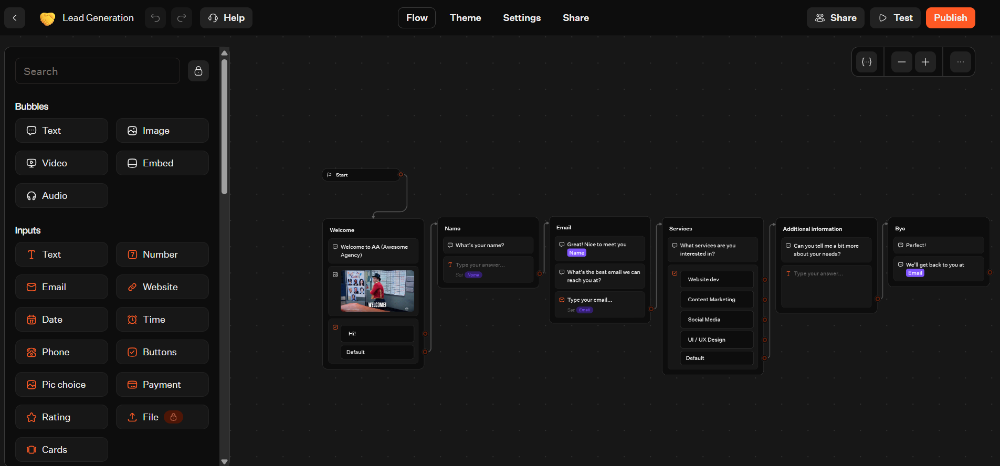
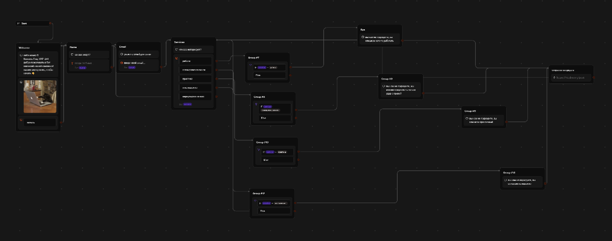
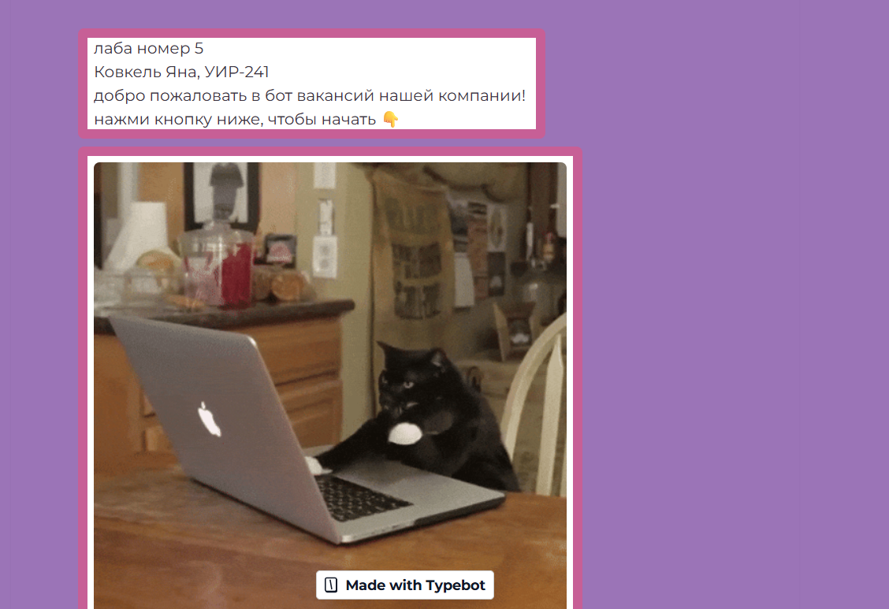
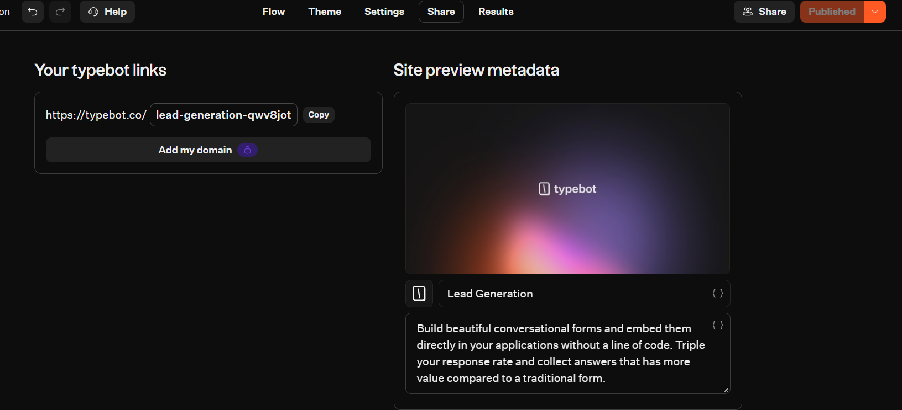

# Лабораторная работа №5. Чат-боты

**Студент:** Ковкель Яна
**Группа:** УИР-241
**Трек:** C. TypeBot

## Ссылка на бота

https://typebot.co/lead-generation-qwv8jot

## Краткое описание выбранного трека

Выбран трек **C (TypeBot)**. Взят готовый шаблон **Lead Generation**,
русифицирован, дополнен условиями и интеграцией. Бот представляет собой
шутливый опрос: пользователь вводит имя,
email, выбирает один из четырёх вариантов, после чего бот выдаёт соответствующее
сообщение и отправляет данные лида на внешний HTTP-сервис.

## Какие AI-промпты использовались

1. Разбиралась с проблемой почему не видны все кнопки
2. Настраивала HTTP запрос
2. Для оформления отчета

## Какие блоки/ноды/элементы освоены

| Элемент | Назначение |
|---|---|
| Text | Вывод текстовых сообщений |
| Image | Вывод картинки |
| Input (Text) | Ввод имени и email |
| Input (Choice) | Выбор из 4 вариантов |
| Variable | Сохранение ответов (Name, Email, Service) |
| Condition | 4 условия для проверки выбора |
| HTTP Request | Отправка данных на `https://httpbin.org/post` |
| Redirect | Переходы между блоками |
| Theme | Кастомизация внешнего вида |

## Скриншоты

### Шаблон «до» (английский)

### Итоговая схема с условиями и HTTP Request

### Тема

### Публикация и ссылка

### Результат диалога

## Экспорт JSON

Файл экспорта: [`../exports/flow-01-bot.json`](../exports/flow-01-bot.json)

## Описание изменений

По сравнению с шаблоном:
1. **Русифицированы** все тексты, кнопки, плейсхолдеры, сообщения об ошибках.
2. **Добавлено 4 условия (Condition)** — по одному на каждый вариант выбора.
3. **Добавлены переменные** `Name`, `Email`, `Service`.
4. **Добавлен HTTP Request** — отправка данных на `https://httpbin.org/post`
   с телом `{ name, email, service }`.
5. **Сменена тема** — фиолетовый фон, розовые рамки, кастомный брендинг.
6. **Опубликован бот** — доступен по web-ссылке.

## Выводы

TypeBot — это low-code инструмент для создания чат-ботов с
ветвлением, переменными и интеграциями. В ходе работы я освоила создание
блоков, настройку условий, работу с переменными, отправку HTTP-запросов
и публикацию бота. Также я научилась работать с вкладкой Results в TypeBot для просмотра логов и отладки запросов. Главная сложность была в настройке кнопок выбора: в шаблоне они изначально не отображались. В целом TypeBot позволяет быстро
собрать рабочего бота без программирования, но требует внимательности
к деталям настройки