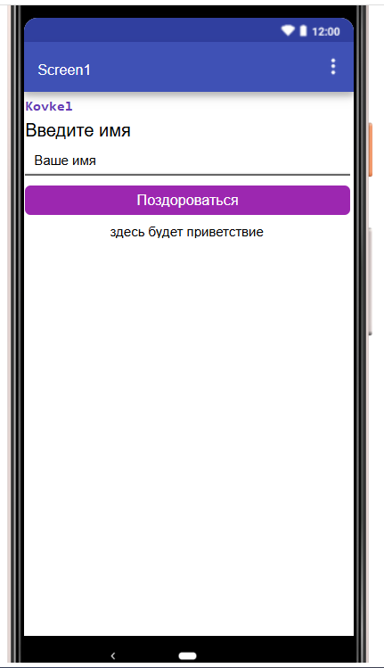
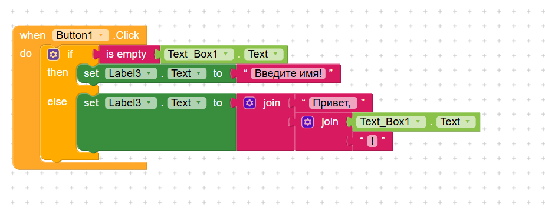
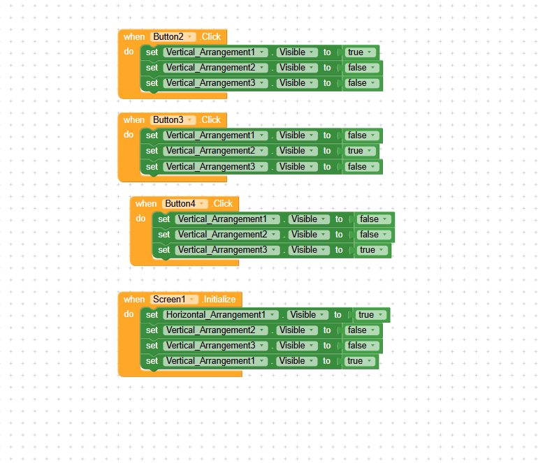

# Лабораторная работа №6 (Kodular)

## 1. Базовое задание: Приложение «Приветствие»

**Реализованный функционал:**
Создан первый экран приложения, содержащий обязательные элементы: заголовок «Введите имя», текстовое поле (TextBox) с подсказкой «Ваше имя», кнопку «Поздороваться» и лейбл для вывода результата. В верхней части экрана размещен лейбл с фамилией на английском языке 

**Логика работы (Блоки):**
При нажатии на кнопку срабатывает условный оператор `if`. С помощью блока `is empty` проверяется, пустое ли текстовое поле:
- Если поле пустое, в нижний лейбл выводится текст «Введите имя!».
- Если поле заполнено, с помощью блока `join` формируется приветствие: «Привет, » + введенное имя + «!».

**Скриншоты базовой части:**

## 2. Ачивка 3: Bottom Navigation (Нижнее меню)

**Описание:**
В приложении реализована навигация по трем разделам («Главная», «Инфо», «Настройки») с помощью нижнего меню. Переключение между разделами происходит за счет изменения видимости макетов (Layout).

**Использованные компоненты:**
1. **VerticalArrangement (Layout1, Layout2, Layout3):** Три вертикальных макета, которые занимают весь экран. В первом находится наше базовое приложение (приветствие), во втором — текст с информацией, в третьем — текст настроек.
2. **HorizontalArrangement:** Нижняя панель, которая служит контейнером для кнопок меню.
3. **Button (Button2, Button3, Button4):** Три кнопки в нижнем меню для переключения вкладок.

**Использованные блоки (Логика):**
1. **`Screen1.Initialize`:** При запуске приложения скрываются вторая и третья вкладки (`Visible = false`), а нижнее меню и первая вкладка становятся видимыми (`Visible = true`).
2. **`Button.Click`:** Для каждой кнопки меню написан свой обработчик нажатия.
3. **`set ... Visible to`:** При нажатии на кнопку «Главная» макет `Layout1` становится видимым (`true`), а `Layout2` и `Layout3` скрываются (`false`). Аналогично настроены кнопки «Инфо» и «Настройки» для показа соответствующих макетов.

**Скриншот логики Ачивки 3:**

**Решение проблемы с «прыгающим» меню:**
При тестировании выяснилось, что при переключении на вкладки «Инфо» и «Настройки» нижнее меню поднималось вверх, так как невидимые макеты не занимали места на экране. Для исправления этого бага в Designers был добавлен компонент **Space**  с параметрами `Width = Fill parent` и `Height = Fill parent`. Он был размещен в дереве компонентов между макетами вкладок и нижним меню (HorizontalArrangement). Теперь занято всё свободное пространство, и нижнее меню всегда надежно прибито к нижней части экрана независимо от того, какая вкладка открыта.

## 3. Использованные AI-промпты
1. «Как в Kodular сделать так, чтобы при нажатии на кнопку проверялось, пустое ли текстовое поле, и выводилось сообщение?»
2. «Почему у меня блок с if не влазит в блок с when?»
3. «Как реализовать нижнее меню в Kodular?»

## 4. Освоенные компоненты и блоки
**Компоненты:** Label, TextBox, Button, VerticalArrangement, HorizontalArrangement.
**Блоки:** `when ... do`, `if / then / else`, `is empty`, `join`, `set ... to`, `Visible` (true/false), `Initialize`.

## 5. Выводы
В ходе выполнения работы я попробовала поработать с платформой визуального программирования Kodular. Настраивала интерфейс, работала с макетами для структурирования элементов, а также строила логику с помощью blocks. Реализовала ачивку 3 (Bottom Navigation) показала, как создавать многостраничный интерфейс в рамках одного экрана
